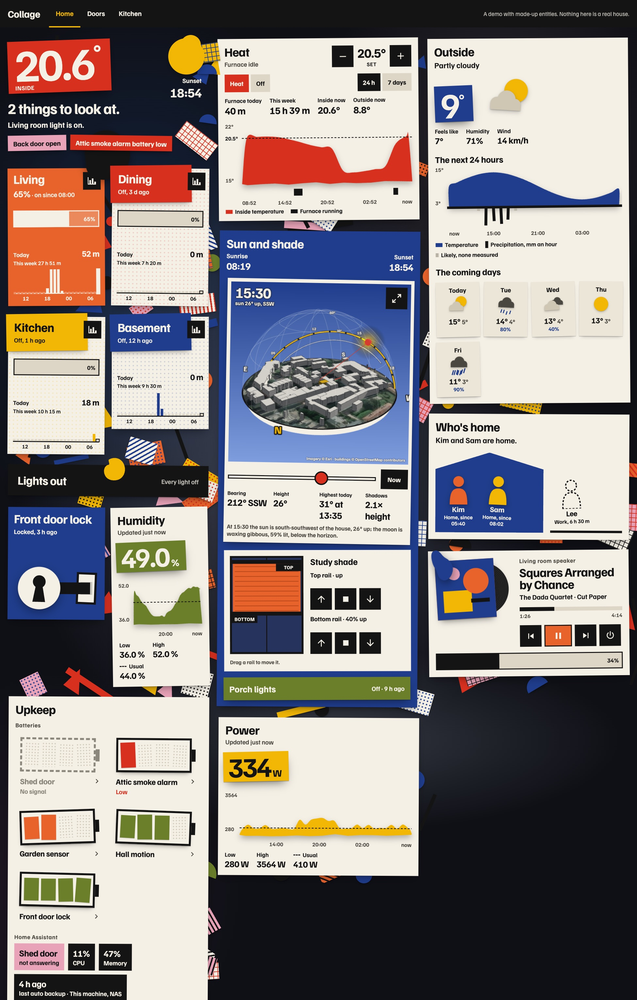
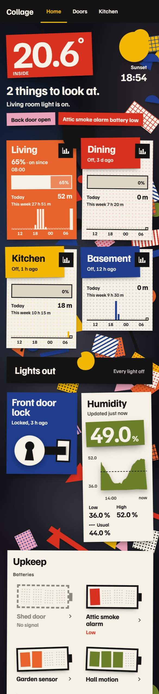
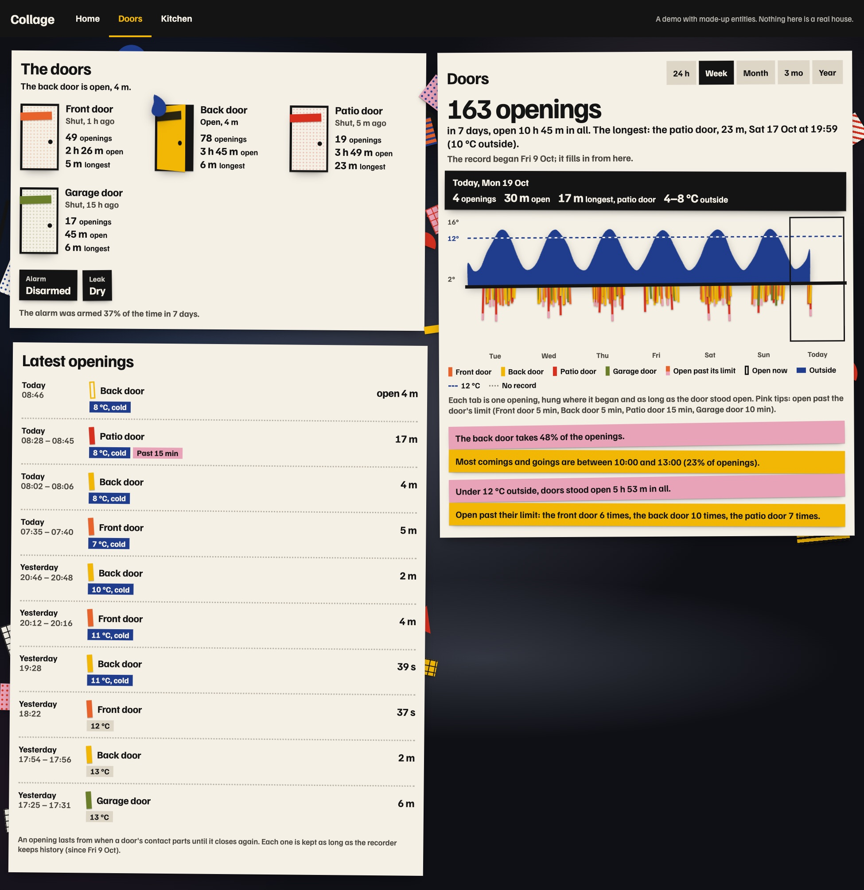
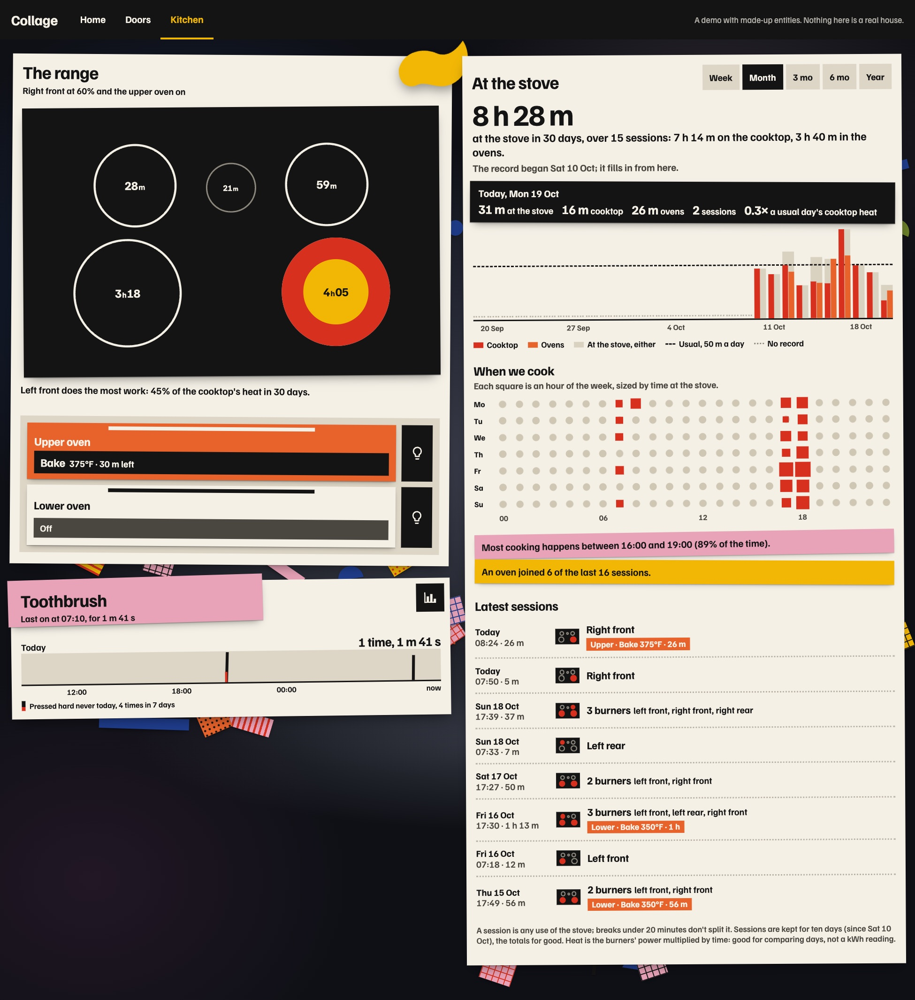

# Collage

A theme and a card library for [Home Assistant](https://www.home-assistant.io/) dashboards, after
the cut-paper collages of Jean Arp and Sophie Taeuber-Arp. The house is cut paper pinned to a dim
wall: each room is a sheet of poster colour, whatever is on right now carries an organic Arp form,
and loose bits of patterned paper scatter around the cards. History is cut paper too: an hour as a
rectangle, a day's temperature as one hand-cut form, the sky over the house as a paper dome you
can turn.



It is the opposite of a heads-up display. Nothing is glass, nothing is rounded, every card is
tilted a degree or two, and the first screen answers "is everything all right?" in a sentence.

**See it without installing anything:** clone the repository, run `node tools/serve.mjs`, and open
<http://localhost:8770/demo/>. The demo runs every card on a pretend Home Assistant with made-up
entities.

| Phone | Doors | Kitchen |
|---|---|---|
|  |  |  |

## What's in it

- **`themes/collage.yaml`**: the theme. It makes Home Assistant's own cards, dialogs, header and
  sidebar into ink on paper with square corners and a pinned shadow, and puts dashboard views on a
  dim wall. It is safe as your default theme.
- **`dist/collage.js`**: sixteen cards in one file, vanilla web components with no build step and
  no dependencies (the 3D sky loads [three.js](https://threejs.org/) when it is shown).
- **`dist/familjen-grotesk.woff2`**: the face, [Familjen Grotesk](https://github.com/Familjen-Sthlm/Familjen-Grotesk)
  (SIL Open Font License), loaded by the cards; nothing to set up.
- **`examples/`**: a whole dashboard in YAML, and packages that keep long-term statistics for the
  door and stove cards.

## Install

### The cards, through HACS

**[Open Collage in HACS on your Home Assistant.](https://my.home-assistant.io/redirect/hacs_repository/?owner=alejandroerickson&repository=home-assistant-collage-theme&category=plugin)**
Or by hand:

1. In [HACS](https://hacs.xyz/), open the three dots > **Custom repositories**, add
   `https://github.com/alejandroerickson/home-assistant-collage-theme` with the type
   **Dashboard**, then find **Collage** and download it.
2. HACS normally adds the resource for you. If a card says it is not found, add it yourself:
   Settings > Dashboards > three dots > Resources > Add resource, URL
   `/hacsfiles/home-assistant-collage-theme/collage.js`, type **JavaScript module**.

### The cards, by hand

Copy everything in `dist/` to `/config/www/collage/`, and add the resource
`/local/collage/collage.js` as a **JavaScript module**. It must be a module: the cards find their
font next to themselves.

### The theme

HACS installs one kind of thing per repository, so the theme is one file you copy:

1. Make sure `configuration.yaml` loads themes:

   ```yaml
   frontend:
     themes: !include_dir_merge_named themes
   ```

2. Copy `themes/collage.yaml` to `/config/themes/collage.yaml`, restart Home Assistant (or call
   `frontend.reload_themes`).
3. Choose **Collage** in your profile, or set `theme: Collage` on each view of a dashboard. Use it
   on every view, and as the default theme if you like: then the dialogs a card opens are paper too.

### With an agent

If you use a coding agent (Claude Code, Codex, Cursor), point it at this repository and ask. The
agent instructions in [AGENTS.md](AGENTS.md) and the skill
[`install-collage`](.agents/skills/install-collage/SKILL.md) tell it how to install the theme and
cards, find your entities and lay out a first dashboard without changing anything you didn't ask
for. For example:

> Install the Collage theme from github.com/alejandroerickson/home-assistant-collage-theme on my
> Home Assistant and make me a Home view with my lights, thermostat and weather. Show me the YAML
> before you change anything.

## The cards

Every card is `type: custom:collage-<name>-card`. Colours are the theme's six papers, `cobalt`,
`yellow`, `orange`, `red`, `olive` and `pink`, plus `black` and `paper` (any CSS colour works too).
Forms are the five Arp shapes, `1` to `5`. A tap does the common thing, holding opens Home
Assistant's details, and every control is at least 44 pixels.

### Room: `collage-room-card`

A light or switch as a sheet of paper; the whole sheet is the toggle. Off, it is paper with a strip
of its colour; on, the sheet turns its colour and an Arp form lands on it. Today's hours on, this
week's, and a strip of the last 24 hours, an hour per rectangle. A dimmable light gets a brightness
bar to drag. The black button turns the card over: hour, day and week, and level buttons.

```yaml
type: custom:collage-room-card
entity: light.living_room
name: Living        # optional; the entity's name otherwise
color: orange       # the room's paper
form: 1             # the Arp form when it is on, 1 to 5
form_color: black
```

### Status: `collage-status-card`

The house in one sentence, straight on the wall: the inside temperature on a red patch, the next
sunrise or sunset, "All quiet. Every light is off." or "2 things to look at.", which lights are on,
and a tag for each alert that applies (a tap opens it).

```yaml
type: custom:collage-status-card
temperature: sensor.inside_temperature   # a sensor, or a weather entity
climate: climate.thermostat              # optional: says HEATING while it heats
lights: [light.living_room, light.kitchen]
alerts:
  - entity: binary_sensor.back_door
    state: "on"                 # or above: 30, or below: 15
    text: Back door open        # optional; {state} is replaced by the reading
    level: error                # red instead of pink
    navigate: /lovelace/doors   # optional: go there instead of opening the entity
```

### Action: `collage-action-card`

One black bar, one action, with " — done" in yellow when it has run.

```yaml
type: custom:collage-action-card
name: Lights out
note: Every light off      # optional
action: light.turn_off     # domain.service
data: { entity_id: [light.living_room, light.kitchen] }
```

### Heat: `collage-climate-card`

A thermostat: the setpoint between two square buttons, its modes, and the last 24 hours or 7 days
of the inside temperature as one red form with a hand-cut bottom edge. The setpoint is a dashed
line; black bars under the form are when the heating (or cooling) ran, totalled for today and the
week.

```yaml
type: custom:collage-climate-card
climate: climate.thermostat
temperature: sensor.inside_temperature   # optional; the thermostat's reading otherwise
outside: weather.home                    # optional: "Outside now"
name: Heat
runner: Furnace                          # optional: "Furnace running", "Furnace today"
```

### Sun: `collage-sun-card`

The sun's arc as a paper fan, with sunrise and sunset. With `map: true` the arc becomes the sky over
your house in 3D: the 180 metres around Home Assistant's home location photographed from above
(Esri imagery), the buildings from OpenStreetMap stood up on it, and today's paths of the sun and
the moon on a glass dome, with the real light and shadows. Drag to turn it, pinch to zoom, slide
through the day. Optionally a shade (one cover, or a top-down bottom-up shade's two rails) drawn in
its window, whose rails you drag, and a light as a bar.

```yaml
type: custom:collage-sun-card
map: true            # or { buildings: false }, or { lot: [[lat, lon], ...] } to outline your lot
rails:               # optional
  - entity: cover.shade_top_rail
    name: Top rail
    from_top: true
  - entity: cover.shade_bottom_rail
    name: Bottom rail
shade_name: Study shade
status: sensor.shade_node_status   # optional, for a Z-Wave shade: "Not answering" and Wake it
ping: button.shade_ping
lights: light.porch                # optional
```

The 3D sky sends the home location's surroundings, not the location itself, to three services:
map tiles from Esri, building footprints from OpenStreetMap (Overpass, or the OSM API), and
three.js from jsDelivr. Leave `map` out and the card asks nothing of anyone.

### Upkeep: `collage-upkeep-card`

The chores the house asks for. Batteries as cut-paper batteries, four cells each, one per quarter
of charge, with no percentage (the screen reader still says it); "Low" under 30%, "No signal" when
there is no reading. Devices not answering, the host's CPU and memory, and the last automatic and
manual backups and where they are kept.

```yaml
type: custom:collage-upkeep-card
batteries: [sensor.front_door_lock_battery, sensor.hall_motion_battery]
offline: [binary_sensor.shed_door]       # said "not answering" when unavailable
cpu: sensor.system_monitor_processor_use
memory: sensor.system_monitor_memory_usage
host: Pi                                 # optional: "Pi CPU"
backup: sensor.backup_last_successful_automatic_backup
locations: { "backup.local": "This machine", "hassio.nas": "NAS" }
```

### Sensor: `collage-sensor-card`

Any reading on a patch of its colour, and its last day as one cut-paper form with the low, the
high and the usual (the median, dashed). A sensor that isn't a number shows its state in words.

```yaml
type: custom:collage-sensor-card
entity: sensor.living_room_humidity
name: Humidity
color: olive
hours: 24        # optional
decimals: 0      # optional
```

### Weather: `collage-weather-card`

The sky cut from paper (a yellow sun, clouds of darker paper, cobalt rain, a yellow bolt), the
temperature on a cobalt patch, the next 24 hours as one cobalt form with each hour's rain hanging
under it as an ink tab, and the coming days as slips. Any weather integration with forecasts.

```yaml
type: custom:collage-weather-card
entity: weather.home
name: Outside
days: 5
```

### Media: `collage-media-card`

A media player as a record sleeve: the cover art pasted on as a cut photo, the record peeking out
and turning while it plays, the title and artist, square buttons for what the player supports, and
a volume bar.

```yaml
type: custom:collage-media-card
entity: media_player.living_room_speaker
color: orange    # the record's label, and the sleeve without art
```

### Lock: `collage-lock-card`

A keyhole on a paper disc and a bolt that slides into its strike. Cobalt when locked, yellow when
unlocked, red when jammed. One tap locks; unlocking takes a second tap within four seconds.

```yaml
type: custom:collage-lock-card
entity: lock.front_door
confirm: true    # false: one tap unlocks
code: "1234"     # optional, for a lock that asks for a code (anyone who can open the dashboard can read it)
```

### People: `collage-people-card`

Who is home, as paper figures standing inside a cobalt house; whoever is out waits outside it,
dashed, with the zone they are in. Reads only each person's state.

```yaml
type: custom:collage-people-card
people:
  - person.kim
  - entity: person.sam
    color: yellow
```

### The doors: `collage-doors-now-card`

Door contacts as paper doors that swing open in their colour, each with its openings, time open and
longest opening in the span; the alarm and any other sensors (a leak sensor, say) as tags. It only
observes: nothing here arms or unlocks anything.

```yaml
type: custom:collage-doors-now-card
doors:
  - entity: binary_sensor.front_door
    color: orange
    limit: 5         # minutes it may stand open before its openings are marked; 15 by default
  - binary_sensor.back_door
alarm: alarm_control_panel.home
sensors:
  - entity: binary_sensor.basement_leak
    name: Leak
    "on": Wet!
    "off": Dry
```

### Doors: `collage-doors-card`

Every opening hung under the outside temperature, from 24 hours to a year: a tab in the door's
colour as long as it stood open, a pink tip when it was past its limit, the temperature as one
cobalt form with a dashed cold line. A readout bar reads the day you point at; findings say only
what the record can back. With `log: true` it is the latest openings instead.

```yaml
type: custom:collage-doors-card
doors: [binary_sensor.front_door, binary_sensor.back_door]
outside: weather.home     # or a temperature sensor
cold: 12                  # optional; 12 °C or 54 °F by default
log: false
```

Raw history reaches back as far as the recorder keeps it (ten days by default).
[`examples/packages/collage_doors.yaml`](examples/packages/collage_doors.yaml) keeps long-term
statistics per door, and the cards read them for spans beyond that.

### Toothbrush: `collage-brush-card`

An Oral-B brush (the Oral-B integration): each run cut out and pinned to the day, a live timer and
its sections while it runs, a red "Pressing hard" tag, and on the back an hour, a day or a week.

```yaml
type: custom:collage-brush-card
entity: sensor.toothbrush
color: pink
```

### The range and At the stove: `collage-range-card`, `collage-stove-card`

A GE range on the [SmartHQ](https://github.com/simbaja/ha_gehome) integration from above: each
burner as a ring holding its time in the span, a burner that is on as a red disc with a yellow
heart as wide as its power, the ovens as paper doors that turn orange when on. At the stove: time
at the stove from a week to a year against the usual, a grid of when in the week you cook, and the
latest sessions as slips. Heat is power times time, a relative measure, never kWh.

```yaml
type: custom:collage-range-card     # or collage-stove-card
appliance: abc1234567     # the prefix of the range's entity ids
statistics: kitchen       # the package's sensors (examples/packages/collage_stove.yaml), or false
```

The layout is a five-burner cooktop with a warmer and a double oven; `burners` and `ovens` replace
it (see the comment at `kitchenOf` in `dist/collage.js`).

## Make it yours

Change the six paper colours at the top of `themes/collage.yaml` and every card follows. To make a
new card, or change one, read [DESIGN.md](DESIGN.md) (the design system: what each colour means,
the rules) and [PRODUCT.md](PRODUCT.md) (who it is for), and work against the demo, which runs
your change on a pretend house: `node tools/serve.mjs`, then `node tools/shoot.mjs` for phone and
desktop screenshots.

### Design with Impeccable

The theme was designed with [Impeccable](https://impeccable.style), a design toolkit for coding
agents by Paul Bakaus, and `DESIGN.md` and `PRODUCT.md` are in its format. If you extend Collage
with an agent, install it first: it keeps the agent to the design system and catches the generic
look this theme exists to avoid.

```sh
npx impeccable install            # in your project, then follow the prompts
```

In Claude Code: `/plugin marketplace add pbakaus/impeccable`, then install Impeccable from
`/plugin`. Elsewhere: `npx skills add pbakaus/impeccable`. Then ask your agent to `/impeccable`
critique, polish or extend a card.

## Credits

After the collages of Jean Arp and Sophie Taeuber-Arp. Familjen Grotesk by Familjen STHLM (SIL Open
Font License 1.1, `dist/familjen-grotesk-OFL.txt`). The 3D sky uses three.js (MIT), imagery © Esri
and building footprints © OpenStreetMap contributors. Icons are Home Assistant's Material Design
Icons.

## License

MIT, except the font, which keeps its own license. See [LICENSE](LICENSE).
